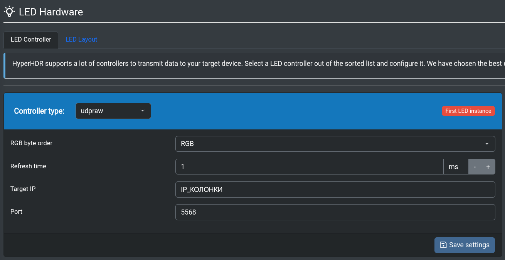
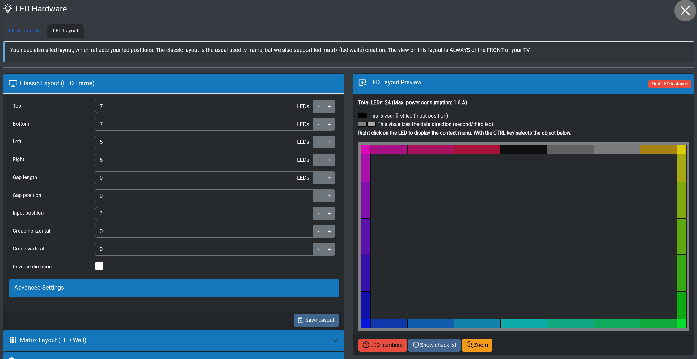
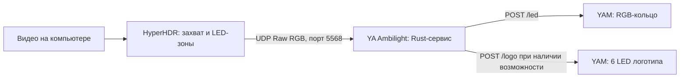

# YA Ambilight

Универсальный сервисный `.yap`-пакет: получает цветовые зоны от [HyperHDR](https://github.com/awawa-dev/HyperHDR) и показывает их на RGB-кольце Яндекс Станции через [YAM](https://github.com/nyakokitsu/yam). На Миди может также окрашивать шесть светодиодов логотипа, если установленная версия YAM предоставляет `led.logo.rgb` и маршруты `/logo`.

Пакет работает как **один Rust-процесс**. Он не пишет напрямую в `/sys/class/leds` и не меняет файлы прошивки: запись и возврат штатной подсветки выполняет YAM.

## Совместимость

| Колонка / профиль YAM | RGB-зоны кольца | Проверка YA Ambilight |
| --- | ---: | --- |
| Лайт 1 (`micro`, `yandexmicro`) | 3 | Пройдён интеграционный тест с подменой YAM; на колонке не проверено |
| Лайт 2 (`plum`) | 3 | Пройдён интеграционный тест с подменой YAM; на колонке не проверено |
| Мини 2 (`mini2`) | 6 | Пройдён интеграционный тест с подменой YAM; на колонке не проверено |
| Миди (`midi`, `cucumber`) | 24 | Кольцо проверено на реальной колонке; также пройден интеграционный тест |

Числа в таблице — количество **физических RGB-светодиодов кольца**, которые YAM объединяет в адресуемые зоны. Это не число зон экрана в HyperHDR: сервис умеет пересчитывать их на кольцо. На Миди есть ещё 6 отдельных RGB-светодиодов логотипа; управление ими пока не подтверждено на реальной колонке.

Пакет запускается на AArch64-колонке, если YAM сообщает `led.ring.rgb`. Число зон берётся из ответа `/device`: из `led_count` либо возможности `led.ring.N`. Профили и числа зон сверены с [исходниками YAM](https://github.com/nyakokitsu/yam/blob/main/src/main.rs). Проверяйте **фактический список возможностей вашей колонки** на главной странице YAM: название модели само по себе не гарантирует доступ к кольцу. Другие модели с `led.ring.rgb` теоретически подходят, но в этой таблице их работоспособность не заявлена.

Логотип включается только при сочетании **24-зонного кольца** и `led.logo.rgb`. Если YAM не предоставляет эту возможность, кольцо продолжает работать без логотипа. Если функция заявлена, но `/logo` отвечает ошибкой, пакет записывает её в журнал и оставляет работающим кольцо. Матрицы, белые сегменты часов и экраны через этот пакет не управляются.

Готовый скрипт сборки создаёт **AArch64 musl** пакет. Для колонки с другой архитектурой нужен соответствующий Rust target и отдельная сборка.

## Требования

1. Установленный и запущенный YAM на колонке. Сервисный пакет восстанавливается после запуска `yamd`; автозапуск самого `yamd` настраивается отдельно.
2. В веб-интерфейсе YAM включено **«Разрешить бинарники плагинов»**, затем нажато **«Сохранить»**.
3. HyperHDR и колонка доступны друг другу по сети. Используемый по умолчанию UDP-порт — `5568`.
4. Для сборки: Rust с `rustup` и target `aarch64-unknown-linux-musl`. Скрипт находит `rust-lld` в установленном toolchain; при необходимости укажите свой линкер через `CARGO_TARGET_AARCH64_UNKNOWN_LINUX_MUSL_LINKER`.

## Установка / сборка `.yap`

Готовый `.yap` для AArch64 доступен на странице [Releases](https://github.com/artimkaf/ya-ambilight/releases). Рядом публикуется файл `.sha256` для проверки загрузки. При отправке тега `vX.Y.Z` GitHub Actions проверяет версию пакета, запускает Rust-тесты, собирает `.yap` и создаёт релиз.

Если хотите собрать пакет самостоятельно:

```sh
rustup target add aarch64-unknown-linux-musl
./build-yap.sh
```

Получится `ya-ambilight-universal-aarch64.yap`. В архив входят `plugin.toml`, `config.toml` и статически собранный бинарный файл. Настройки из [`package/config.toml`](package/config.toml) попадают в архив **на момент сборки**. Каталоги `target/`, готовый бинарник и `.yap` не хранятся в Git.

## Установка на колонку

Подставьте IP своей колонки вместо примера:

```sh
export YAM_URL=http://192.168.1.5:8099
yam install ya-ambilight-universal-aarch64.yap
yam enable ya-ambilight-universal
yam ps
yam logs ya-ambilight-universal
```

`yam enable` используйте **один раз** для нового пакета. В текущей реализации YAM повторный вызов на уже включённом пакете переключит его в выключенное состояние. После изменения конфигурации и пересборки обновите пакет так:

```sh
yam stop ya-ambilight-universal
yam install ya-ambilight-universal-aarch64.yap
yam run ya-ambilight-universal
```

Если раньше стоял `ya-ambilight` или `ya-ambilight-midi-logo`, остановите и отключите его перед запуском этого пакета: два сервиса не смогут одновременно слушать порт `5568` и управлять одним кольцом.

В интерфейсе YAM пакет отображается как **YA Ambilight**; его технический ID в командах `yam` остаётся `ya-ambilight-universal`.

## Настройка HyperHDR

1. Настройте захват изображения на компьютере и убедитесь, что в **Live Video** HyperHDR виден меняющийся кадр. Способ захвата зависит от системы; на Wayland обычно нужен PipeWire/Portal, а Linux framebuffer подходит лишь там, где он действительно содержит изображение.
2. В **LED Hardware → LED Controller** выберите **UDP Raw** (`udpraw`), порядок байтов **RGB**, укажите IP колонки и порт `5568`. Сохраните настройки.

   

3. В **LED Hardware → LED Layout** задайте виртуальные зоны по периметру экрана. На примере для Миди: **Top 7, Bottom 7, Left 5, Right 5**, `Input position` — **3**, `Gap length` — **0**. На предпросмотре должно быть **24 LED**; сохраните раскладку. Для другой колонки число виртуальных зон может отличаться: сервис пересчитает их на физическое кольцо.

   

4. Сохраните настройки и включите вывод LED в HyperHDR.

Если цвета появляются в неправильных физических местах, сначала используйте `test_mode = "zones"` из конфигурации пакета, затем подберите `ring_offset` и `ring_reverse`. Если перепутаны именно цветовые каналы, используйте `test_mode = "rgb"` и настройте `channel_order`. После проверки верните `test_mode = "off"`, пересоберите и обновите пакет.

## Настройки пакета

| Ключ | По умолчанию | Что меняет |
| --- | --- | --- |
| `bind` | `0.0.0.0:5568` | UDP-адрес и порт приёма |
| `max_input_blocks` | `490` | Максимальное количество виртуальных RGB-зон в пакете |
| `frame_rate` | `15` | Максимальная частота отправки кадров в YAM, 1–60 кадров/с |
| `stream_timeout_ms` | `1500` | Время без кадров перед действием `loss` |
| `loss` | `release` | `release` возвращает штатный режим; `black` оставляет чёрный кадр |
| `brightness` | `0.35` | Общий множитель яркости, 0–1 |
| `gamma` | `1.0` | Степень цветовой коррекции, 0,1–4 |
| `red_gain`, `green_gain`, `blue_gain` | `1.0` | Множители отдельных каналов, 0–4 |
| `channel_order` | `RGB` | Порядок каналов; например `GRB`, если красный и зелёный перепутаны |
| `ring_offset` | `0` | Циклический сдвиг по модулю числа LED кольца |
| `ring_reverse` | `false` | Обратное направление обхода кольца |
| `logo_mode` | `average` | `average`, `zones` или `off`; действует только при поддержке logo в YAM |
| `test_mode` | `off` | `off`, `zones` или `rgb` |

Снижение `brightness` может делать цвета визуально тусклыми. При настройке сначала проверьте захват HyperHDR и порядок зон, затем подберите комфортную яркость.

## Диагностика

- **Пакет помечен несовместимым:** проверьте на главной странице YAM наличие `led.ring.rgb`. Logo-функция необязательна.
- **`yam ps` пустой или сервис сразу завершается:** включите бинарники плагинов в настройках YAM, затем посмотрите `yam logs ya-ambilight-universal`.
- **`Address in use (os error 98)`:** порт `5568` уже слушает другой экземпляр Ambilight. Остановите старый пакет и запустите универсальный снова.
- **`invalid runtime token`:** обычно это старый процесс после переустановки или перезапуска YAM. Остановите пакет и запустите его снова; при повторении проверьте оставшиеся процессы.
- **Пакет работает, но кольцо не реагирует:** проверьте Live Video в HyperHDR, адрес колонки, выбранный драйвер UDP Raw и порт. Для сетевой проверки можно несколько секунд отправлять один красный RGB-блок:

  ```sh
  python3 - <<'PY'
  import socket
  import time

  with socket.socket(socket.AF_INET, socket.SOCK_DGRAM) as sock:
      for _ in range(30):
          sock.sendto(bytes([255, 0, 0]), ("192.168.1.5", 5568))
          time.sleep(0.1)
  PY
  ```

  Замените IP. При `brightness = 0.35` красный будет заметно темнее полного `#FF0000`. После прекращения отправки поток отпустит кольцо через 1,5 секунды.
- **Кольцо работает, логотип нет:** YAM должен сообщать `led.logo.rgb` и иметь маршруты `/logo`, `/logo/off`. Без них пакет намеренно оставляет логотип штатной системе. Наличие 24-зонного кольца само по себе не означает поддержку logo API.

## Локальная проверка

```sh
cargo test --locked
python3 tests/integration.py
```

Интеграционный тест подменяет YAM runtime API и проверяет кольца на 3, 6 и 24 зоны, логотип и отсутствие `/logo`. Он проверяет протокол и обработку кадров, но не физическую подсветку конкретной модели.

## Как это работает



HyperHDR отправляет последовательность RGB-байтов: по три байта на виртуальную зону, без заголовка. Сервис проверяет длину пакета, сохраняет последний корректный кадр из очереди и ограничивает частоту вывода параметром `frame_rate` (по умолчанию 15 кадров/с). При ровно таком же количестве входных и физических зон цвета соответствуют друг другу по индексам. Если входных зон больше, цвета внутри каждого сектора усредняются; если меньше, используется линейная интерполяция вдоль замкнутого периметра.

Затем применяются `gamma`, `brightness`, коэффициенты R/G/B и при необходимости перестановка каналов. `ring_offset` и `ring_reverse` исправляют физическое начало и направление кольца. Смещение действует **только на кольцо**.

Для логотипа `logo_mode = "average"` вычисляет средний R, G и B всех входных зон и отправляет один цвет на каждый из шести logo-LED. При `"zones"` входной периметр делится на шесть равных секторов: например, при 24 зонах группы 0–3, 4–7, …, 20–23. Соответствие физических индексов логотипа этим секторам ещё не проверено на Миди. `"off"` не занимает логотип.

Если кадры не поступают дольше `stream_timeout_ms`, режим `loss = "release"` вызывает `/led/off` и, если логотип был занят, `/logo/off`: YAM возвращает штатную подсветку. `loss = "black"` вместо этого удерживает чёрный кадр. При остановке сервиса YAM завершает процесс; пакет также пытается освободить занятые LED через API при обычном завершении.

## Лицензия

[MIT](LICENSE).
